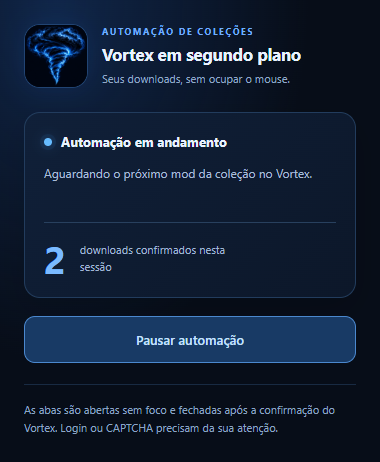

# Vortex em segundo plano

<p align="center">
  
</p>


**Automatize os cliques de download das suas coleções e continue usando o computador.**

Ao instalar uma coleção com downloads manuais, o Vortex pode abrir uma página da Nexus Mods para cada arquivo e exigir outro clique em **Slow download**. Este projeto acompanha a solicitação atual do Vortex, aciona esses botões em abas inativas do Chrome e fecha cada aba após a confirmação de que o Vortex recebeu o download.

O mouse permanece livre para outras tarefas. A transferência e a instalação dos arquivos continuam sob responsabilidade do Vortex e tudo em segundo plano.

## Interface



## Requisitos

| Componente | Requisito |
| --- | --- |
| Sistema | Windows 10 ou 11 |
| Gerenciador | Vortex; integração validada na versão 2.8.2 |
| Navegador | Google Chrome 120 ou superior |
| Conta | Sessão iniciada na Nexus Mods no perfil do Chrome utilizado |
| Operação | Vortex e Chrome abertos; computador acordado e conectado à internet |

O uso comum não exige Python, Node.js, chave de API ou privilégios de administrador. O Chrome precisa ser o navegador usado neste fluxo do Vortex. A instalação da coleção deve estar iniciada no Vortex.

## Instalação

1. **Extraia todo o ZIP** para uma pasta permanente, como `Documentos\Vortex-em-segundo-plano`. Não execute o instalador dentro do arquivo compactado.
2. Execute **Instalar-Vortex.cmd**. Ele prepara a comunicação local e copia os quatro arquivos da extensão para `%APPDATA%\Vortex\plugins\vortex-background-assistant`.
3. No **Chrome**, digite `chrome://extensions` na barra de endereços.
4. Ative **Modo do desenvolvedor**, clique em **Carregar sem compactação** e selecione a subpasta **chrome** da pasta extraída.
5. Feche e abra o **Vortex**. Na tela **Extensions**, confirme que **Vortex em segundo plano** está habilitada. Se habilitá-la exigir outro reinício, reinicie o aplicativo.
6. No menu de extensões do Chrome, fixe **Vortex em segundo plano** para acessar o painel facilmente.

Mantenha a pasta extraída no mesmo local: o Chrome carrega a extensão diretamente dela. Este pacote instala uma extensão local, sem publicação na Chrome Web Store.

### Atualizar

Pause a automação, execute o instalador e reinicie o Vortex. No Chrome, recarregue a extensão se mantiver a mesma pasta; se mudar de pasta, remova a instalação anterior e carregue a nova subpasta **chrome**. Use as duas partes do mesmo pacote para manter a comunicação correspondente.

## Como usar

1. Entre na Nexus Mods no Chrome com a conta usada para baixar a coleção no Vortex.
2. Inicie ou retome a instalação da coleção no Vortex.
3. Quando aparecer a solicitação de download manual, abra o painel da extensão no Chrome e clique em **Iniciar automação**.
4. Confira o primeiro download: o contador deve aumentar quando o Vortex confirmar o recebimento, e a aba gerenciada deve fechar.
5. Continue suas outras tarefas. Os dois aplicativos podem ficar atrás das outras janelas, mas precisam permanecer abertos.

Use **Pausar automação** a qualquer momento. A automação começa pausada a cada abertura do Vortex. O contador registra downloads encaminhados e confirmados nesta sessão; não representa mods cuja instalação já terminou.


## Dados e permissões

A extensão solicita `storage` e `alarms`, além de acesso às páginas da Nexus Mods e à conexão local do Vortex. Não solicita permissão para ler cookies, senhas, histórico ou páginas de outros sites.

O estado das abas gerenciadas fica no armazenamento da extensão. Informações de diagnóstico da página podem ficar temporariamente na sessão do navegador, sem envio a serviços externos. Os links autorizados não aparecem no histórico do painel.

O ZIP não contém a chave local desta instalação, cookies, chave de API ou arquivos de mods. O instalador gera uma chave local na primeira execução. Evite distribuir uma cópia da pasta depois de instalada: os arquivos de configuração passam a conter essa chave.

## Limitações

- Os limites de velocidade e os tempos de espera da Nexus Mods continuam aplicáveis.
- Login, CAPTCHA e verificações do site podem exigir ação manual.
- O projeto não escolhe coleções, resolve conflitos, responde a instaladores interativos ou altera saves.
- Navegador fechado, perfil diferente, modo anônimo ou suspensão do computador interrompem o fluxo.
- Mudanças no Vortex ou no layout da Nexus Mods podem exigir manutenção.
- A compatibilidade foi verificada neste fluxo específico, sem garantia para todas as versões, jogos ou coleções.

## Solução de problemas

| Sintoma | O que verificar |
| --- | --- |
| **Vortex não conectado** | Confirme a extensão habilitada, reinicie o Vortex e confira se as duas partes vieram da mesma pasta do projeto. |
| Extensão ausente no Chrome | Confira `chrome://extensions` e fixe a extensão no menu do navegador. |
| Página aberta, mas download parado | Abra a aba gerenciada e procure login, CAPTCHA ou erro. Resolva manualmente e retome pelo painel; recarregue a página se necessário. |
| Aguardando o próximo mod | Confira se há uma solicitação de download manual pendente no Vortex. |
| Comportamento antigo após atualização | Reinicie o Vortex e recarregue a extensão em `chrome://extensions`. |

## Remoção

Pause a automação e remova a extensão em `chrome://extensions`. Feche o Vortex e exclua somente `%APPDATA%\Vortex\plugins\vortex-background-assistant`. Depois, se desejar, exclua a pasta extraída do projeto. Os mods, arquivos baixados e coleções instaladas permanecem no Vortex.

## Me paga um café? ☕

Se este projeto te poupou tempo e alguns bons cliques, você pode apoiar o desenvolvimento me pagando um café pelo Pix. Qualquer valor é bem-vindo, e o apoio é totalmente opcional. Obrigado por ajudar a manter o projeto andando!

**Chave Pix: caiaelucasft@gmail.com**

## Deixe uma estrela ⭐

Se a ferramenta te ajudou, considere deixar uma estrela aqui no GitHub. Isso ajuda outras pessoas a encontrarem o projeto e me mostra que ele está sendo útil. É muito bom saber que algo que começou para resolver um incômodo também está facilitando a vida de mais gente. Obrigado pelo apoio!

Projeto independente, sem afiliação com Nexus Mods, Vortex ou Google.

## Desenvolvimento e validação

```text
chrome/                Extensão do Google Chrome
vortex/                Extensão do Vortex
tests/                 Testes automatizados
Instalar-Vortex.cmd    Instalador para Windows
Instalar-Vortex.ps1    Preparação local e cópia dos arquivos
build.js               Geração da configuração para desenvolvimento
VALIDACAO.md           Escopo e resultados das verificações
```

Para desenvolvimento, use Node.js 20 ou superior. Não há dependências externas para os testes de lógica:

```sh
node build.js
node --test tests/*.test.js
```

O fluxo de cliques e a troca entre solicitações foram confirmados pelo usuário em uma coleção real. Consulte **VALIDACAO.md** para distinguir essas confirmações dos testes com páginas e filas simuladas.


